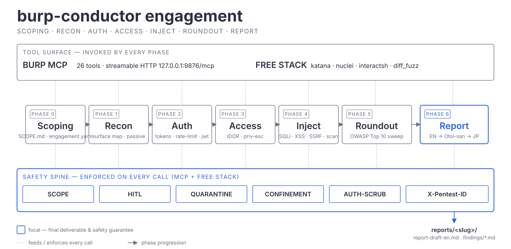

# burp-conductor — MCP pentest harness

An **MCP plugin** (server + slash-command skills + hooks) that conducts a
full web-app engagement from any MCP-capable AI harness — Claude Code,
Codex, Cline, Cursor, or any other MCP client.

> **Safe probes only.** Every phase skill is written to **verify, not exploit** —
> single-request checks, canary-based SSRF (interactsh), reflected-XSS markers
> that don't execute privileged actions, SQLi probes that read error state
> rather than drop or exfiltrate data, auth tests that stop at proof-of-access.
> No destructive payloads, no data exfiltration, no persistence, no lateral
> movement. Deliverable is "find the bug, prove it exists, document the fix" —
> not red-team post-exploitation. The HITL gate and `safety.py` enforce this
> at the tool-call layer; the skills enforce it at the methodology layer.

Proxy, scanner, and Repeater/Intruder work is delegated to PortSwigger's
official Burp MCP extension (streamable HTTP at `http://127.0.0.1:9876/mcp`;
SSE as fallback). Recon, SPA crawl, template-based active scanning, OOB
interaction, and novel-injection discovery run outside Burp — a stack of
ProjectDiscovery CLIs plus an in-repo differential fuzzer, invoked via
`Bash` from the phase skills under the same safety spine.



The free stack exists because Burp **Community** ships no Crawl, no Active
Scanner, and no Collaborator. Katana covers crawl (headless Chrome for SPAs),
Nuclei covers active scanning (fast-HTTP and headless passes), interactsh
provides OOB canaries, `tools/diff_fuzz.py` stands in for Backslash-Powered
Scanner. Every free-stack call is scope-checked, HITL-gated, and writes to
the session scratchpad — same rules as MCP tool calls. Rationale and install
matrix in `CLAUDE.md`.

The slash-command skills under `.claude/commands/` are Claude Code-native
(that's where the `/pentest-*` convention is best supported today), but the
MCP server itself is transport-standard — any client that speaks MCP can
call it.

---

## Safety spine

Every tool call — MCP or free-stack Bash — passes through `safety.py`:

| Control | What it does |
|---------|--------------|
| Scope | Rejects any host not in `engagement.yaml` `scope.hosts` |
| HITL | Gates upstream firing tools (`send_http1_request`, `create_repeater_tab`, `send_to_intruder`, scanner trigger) behind explicit "go" |
| Quarantine | Wraps response bodies in `<spotlight>`; `quarantine="true"` stops action |
| Confinement | All writes forced under `reports/` with path-traversal block |
| Auth scrub | Strips `Authorization`, `Cookie`, `Set-Cookie`, `X-API-Key`, `X-Auth-Token` from the JSONL log |
| Identity | Injects a unique `X-Pentest-ID: <company>/<slug>/<yyyy-mm-dd>` header on every outbound call so client blue teams can filter us out of SIEM/WAF |

### Scope containment — defence in depth

Scope gets enforced at two layers so a redirect or scanner follow can't leak traffic across the boundary:

- **Python layer — `safety.check_in_scope` / `is_in_scope` / `filter_in_scope`.** `check_in_scope` raises on the input URL before any MCP tool fires. `is_in_scope` is the non-raising predicate; `filter_in_scope(urls) -> (ok, rejected)` partitions URL lists that come from untrusted sources — scanner output, redirect `Location` headers, extracted links. verified against `tests/test_safety.py::TestScopeFilter`.
- **CLI layer — Katana `-cs '<in-scope-regex>' -do`.** Katana defaults to `-fs rdn` (root-domain), but a 302 cross-domain in a template can still leak. `-cs` sets the crawl-scope regex, `-do` displays out-of-scope endpoints without following them. verified 2026-11-24 against `katana -h`.
- **CLI layer — Nuclei `-dr`.** `-fr` (follow-redirects) is DEFAULT OFF per `nuclei -h`, but `-dr` (disable-redirects) makes the intent unambiguous for template-driven follows. verified 2026-11-24 against `nuclei -h`.
- **Subdomain distinctness.** `api.target.example.com` is NOT `target.example.com` — each host must be listed explicitly in `engagement.yaml`. verified against `tests/test_safety.py::TestScope::test_subdomain_is_distinct`.

---

## Quick install

```bash
# 1. Clone
git clone https://github.com/leehourr/burp-conductor.git
cd burp-conductor

# 2. Install Python package (registers burp-stdio + burp-conductor on PATH)
pip install -e .

# 3. Install slash commands user-globally, so /pentest-* resolve from any dir
#    (Claude Code only — other MCP harnesses skip this step)
burp-conductor install-skills

# 4. Register MCP servers at user scope (one time, per Claude Code install)
cp .mcp.json.example .mcp.json   # or register via `claude mcp add --scope user`

# 5. Install the free stack (one-time)
go install github.com/projectdiscovery/katana/cmd/katana@latest
go install github.com/projectdiscovery/nuclei/v3/cmd/nuclei@latest
go install github.com/projectdiscovery/interactsh/cmd/interactsh-client@latest
nuclei -update-templates
# diff_fuzz ships in-repo at tools/diff_fuzz.py — no install needed
```

## Run from any directory

```bash
cd ~/engagements/acme-corp     # anywhere you want reports written
export BURP_MCP_REPORTS_DIR="$(pwd)/reports"   # optional; defaults to ./reports

# in Claude Code:
/pentest-start acme-corp AcmeCorp app.acme.example,api.acme.example
/pentest-recon acme-corp
# ...through /pentest-report
```

## Phase walkthrough

The engagement moves left-to-right through six phases. Each is a slash command
that reads and writes `reports/<slug>/engagement.yaml` as the single source of
truth — so a fresh session can resume mid-engagement with `/pentest-resume <slug>`.

### 0 · Bootstrap — `/pentest-start <slug> <client> <hosts>`

Create `reports/<slug>/engagement.yaml`, load scope into `safety.py`, print RoE and roadmap.

- **Prereq:** —
- **Tool set:** file writes only. No upstream tools fire.
- **Writes:** `engagement.yaml`, `SCOPE.md`

### 1 · Recon — `/pentest-recon <slug>`

Surface map (endpoints, auth boundary, hidden params, threat model). Passive only — no active probes.

- **Prereq:** start done
- **Tool set:**
  - `katana` fast crawl (`-d 5 -jc`) → `verify_queue` seed
  - `katana -headless -system-chrome` second pass for JS-rendered SPA routes
  - **Param Miner** (BApp, GUI handoff) for hidden headers / cache-key params
  - Burp proxy history reads via `get_proxy_http_history_regex` for passive endpoint discovery
- **Writes:** `verify_queue`, threat-model notes in `engagement.yaml`

### 2 · Auth — `/pentest-auth <slug>`

Login endpoint probes: rate-limit, user enumeration, session handling, JWT weaknesses, reset/MFA flow.

- **Prereq:** recon done; `auth_method_hint` populated
- **Tool set:**
  - `send_http1_request` for per-request probes (HITL per call)
  - `create_repeater_tab` for manual re-fire and header tamper
  - `send_to_intruder` for rate-limit and enumeration (HITL per attack)
  - `Base64Encode` / `Base64Decode` for JWT header + payload swaps (`alg:none`, RS256→HS256)
  - `checkpoint_history` + `replay_history` to carry a fresh session across runs
- **Writes:** findings; session material for downstream phases

### 3 · Access — `/pentest-access <slug>`

Horizontal IDOR (object-level), vertical priv-esc (function-level), business-logic abuse. One object at a time, no mass sweeps.

- **Prereq:** auth done; two valid sessions (for horizontal tests)
- **Tool set:**
  - `send_http1_request` with swapped session cookies / bearer tokens (HITL per call)
  - `create_repeater_tab` for side-by-side user-A / user-B comparison
  - **Autorize** (BApp, GUI, passive alongside) for swarm-replay diff across live traffic
- **Writes:** findings

### 4 · Inject — `/pentest-inject <slug>`

SQLi (error + blind), reflected/stored XSS, SSRF via interactsh canary, HTTP method/content-type tamper, novel injection discovery.

- **Prereq:** access done
- **Tool set:**
  - `nuclei` fast pass on `verify_queue` (`-severity medium,high,critical`)
  - `nuclei -headless -t headless/` for DOM-XSS, prototype pollution, postMessage bugs
  - `nuclei -sf auth.yaml` or `-H` for authenticated replay
  - `interactsh-client` for SSRF / blind-XSS canary (OOB confirmation)
  - `tools/diff_fuzz.py` — in-repo Backslash-Powered Scanner stand-in for novel SSTI / expression-language / custom-parser escapes
  - **Turbo Intruder** (BApp, GUI) for single-packet HTTP/2 race attacks (TOCTOU, coupon replay, MFA race)
  - `send_http1_request` / `create_repeater_tab` for byte-level verification of anything Nuclei flags "tentative"
- **Writes:** findings

### 5 · Roundout — `/pentest-roundout <slug>`

OWASP Top 10:2025 sweep for gaps: platform, client-side, logging, exception.

- **Prereq:** inject done
- **Tool set:**
  - `nuclei -t http/misconfiguration/,http/exposures/` for headers, TLS, exposed panels
  - **Software Vulnerability Scanner** / **Retire.js** (BApp, GUI, passive) for SCA — JS libs + banner CVEs
  - TLS/cipher check via external CLI (`testssl.sh` or equivalent)
  - `send_http1_request` for targeted header + exception triggers (HITL)
- **Writes:** findings closing A05 / A06 / A09 gaps

### 6 · Report — `/pentest-report <slug>`

Assemble the English draft from per-finding markdown, hand off for bilingual delivery, prepare debrief.

- **Prereq:** roundout done
- **Tool set:** file reads + `save_finding` + `write_report`. No upstream Burp tools fire.
- **Writes:** `reports/<slug>/report-draft-en.md`, then → translation → client

---

### Table summary

| Command | Phase | Primary tools | Prereq |
|---------|-------|---------------|--------|
| `/pentest-start` | 0 · Bootstrap | file writes only | — |
| `/pentest-recon` | 1 · Recon | katana (fast + headless), Param Miner, proxy history | start |
| `/pentest-auth` | 2 · Auth | send_http1 · repeater · intruder · Base64 (JWT) · replay_history | recon |
| `/pentest-access` | 3 · Access | send_http1 (swapped session), repeater, Autorize (passive) | auth |
| `/pentest-inject` | 4 · Inject | nuclei (fast + headless + auth), interactsh, diff_fuzz, Turbo Intruder | access |
| `/pentest-roundout` | 5 · Roundout | nuclei (misconfig/exposures), Retire.js / SVS, testssl.sh | inject |
| `/pentest-report` | 6 · Report | file reads, save_finding, write_report | roundout |

Plus one utility: **`/pentest-resume <slug>`** — reads engagement state, prints the status table, suggests the next step. Use it when picking up a stale engagement.

Every phase skill reprints the six-phase roadmap at five anchor moments (start, phase close, blocker, HITL ask, resume) so the harness stays oriented across long sessions.

## Prereqs

- Burp Suite Community (or Pro) with the "MCP Server" BApp extension loaded
  → streamable HTTP MCP at `http://127.0.0.1:9876/mcp` (SSE is a fallback transport only)
- Python ≥ 3.11
- A recent Go toolchain (for `go install` of Katana / Nuclei / interactsh — see each project's README for the current minimum)
- Google Chrome (required for `-headless -system-chrome` passes)
- Chrome configured to proxy through Burp (`--proxy-server=127.0.0.1:8080
  --proxy-bypass-list="<-loopback>"`)

## Config knobs

| Env var | Default | Purpose |
|---------|---------|---------|
| `BURP_MCP_HTTP` | `http://127.0.0.1:9876/mcp` | Upstream Burp MCP URL |
| `BURP_MCP_REPORTS_DIR` | `./reports` in CWD | Where findings + engagement state land |

Scope and identity are loaded per engagement from `engagement.yaml` via
`/pentest-start` — not hardcoded in source.

## Persistence & resume

Burp **Community** has no project-save — close Burp, lose the proxy history, the
Repeater tabs, the Scanner issues, everything. `burp-conductor` sidesteps that
by writing engagement memory to disk as we go, so a fresh Claude Code session
(or a fresh Burp install on a different laptop) can resume mid-engagement with
`/pentest-resume <slug>`. Nothing lives only in Burp's RAM.

Four artefacts, all under `reports/<slug>/`:

| File | Writer | What it holds | Why |
|------|--------|---------------|-----|
| `engagement.yaml` | `start_engagement` + `advance_phase` | Scope, window, identity header, threat model, per-phase status + cursor + artifacts, `verify_queue`, `chains` | **Single source of truth.** `/pentest-resume` reads this one file and prints the two-box status table. Every phase skill reads it on entry and writes back on checkpoint. |
| `YYYY-MM-DD-requests.jsonl` | `log_request` | Full request + response bytes (capped at 8 KB per side), scope-checked, auth-scrubbed, timestamped | Daily append-only trace of every call Claude explicitly logged. Rehydration source for `replay_history` when upstream proxy-history truncates. |
| `YYYY-MM-DD-<sev>-<slug>.md` | `save_finding` | One markdown file per finding, fixed section order (Summary / Repro / Evidence / Impact [Technical + Business] / Remediation / References) | Findings survive the engagement independently of Burp. `/pentest-report` assembles these into the EN draft. |
| `replay-YYYY-MM-DD.jsonl` | `checkpoint_history` → `replay_history` | Snapshot of Burp's proxy history (scope-filtered, auth-scrubbed, full raw bytes up to upstream's 5000-char per-item cap), with flags where truncation hit | Lets us re-fire a prior session's traffic on a fresh Burp install via `send_http1_request`, rewriting auth headers from a fresh login. Pro's Session Handling Rules collapse to this + `inject_auth`. |

**State write cadence:** phase skills write back on three events — phase open
(status → `in_progress`), checkpoint moments (finding filed, queue updated),
and phase close (status → `done` with artifacts list). `advance_phase` stamps
`checkpoint: <utc-iso>` every write, so resume always knows how stale state is.

**Truncation handling.** Upstream Burp MCP caps serialized history items at
5000 chars (hard-coded in `HistoryItemJson.kt`). When `checkpoint_history`
hits that cap it flags the entry; at replay time `write_replay_entry` first
tries to rehydrate from our own `log_request` JSONL (full bytes + full URL
with scheme) before falling back to the truncated snapshot. Scheme is
recorded as `log_url` (recovered) or `port_heuristic` (inferred from port
443/8443/9443) so downstream knows whether to trust it.

**What is NOT persisted:** Repeater tab layout, Intruder attack config,
Scanner issue tree, Burp's own project state. We persist the *engagement*,
not the *tool*. If you need to pick those back up, open the proxy-history
JSONL and re-send the interesting items with `send_http1_request` under HITL.

**Gitignored.** `reports/` never enters git. Engagement output — findings,
logs, screenshots, practice-lab runs — stays on the operator's disk. The
only thing a teammate clones is the harness itself; they recreate the tree
with `/pentest-start`.

---

## Repo layout

- `server.py` — stdio MCP server; proxies to upstream Burp MCP over streamable HTTP (SSE fallback)
- `safety.py` — safety spine (scope, HITL, quarantine, confinement, auth scrub, identity injection)
- `persist.py` — JSONL request log + markdown finding writer + engagement state
- `cli.py` — `burp-conductor install-skills`
- `tools/diff_fuzz.py` — Community-edition Backslash-Powered Scanner stand-in
- `.claude/commands/` — the six `/pentest-*` slash commands (recon / auth / access / inject / roundout / report)
- `templates/engagement.yaml` — engagement state template
- `research/` — walkthrough docs and source citations (HTML; marked `linguist-documentation`)

**Not in the repo:** `reports/` is fully gitignored. Engagement output —
findings, JSONL logs, screenshots, practice-lab runs — stays local. The
harness recreates the tree per engagement from `templates/engagement.yaml`.

## Smoke test

```
burp-stdio
# should print: burp-safety-proxy starting — upstream=http://127.0.0.1:9876/mcp
```

Then in Claude Code with `.mcp.json` present:
- `list_upstream_tools` → list of Burp tools
- `http_get url=http://localhost/` → `[OK]` with wrapped body
- `http_get url=http://evil.com/` → `BLOCKED: out-of-scope host 'evil.com'`

